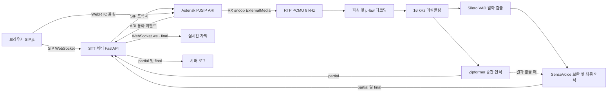

# STT Integration

## 1. 프로젝트 개요

고객의 전화 음성을 텍스트로 변환하여 웹 페이지에 실시간으로 출력하는 STT(Speech-to-Text) 연동 모듈을 구현하는 프로젝트입니다.

Asterisk에서 통화 음성을 수집하고, STT 모델로 인식한 내용을 WebSocket을 통해 웹 페이지에 전달합니다. 사용자는 통화 중 고객의 발화 내용을 실시간 자막으로 확인할 수 있습니다.

주요 기능은 다음과 같습니다.

- Asterisk의 ARI와 ExternalMedia를 이용한 통화 음성 수집
- Zipformer를 이용한 중간 인식과 Silero VAD·SenseVoice를 이용한 발화 감지 및 최종 인식
- WebSocket을 통한 최종 인식 결과 전송과 웹 페이지의 확정 자막 표시
- 브라우저 기반 웹 소프트폰을 통한 통화 및 음성 인식 확인

## 2. 아키텍처 구성도



통화 음성은 PCMU 디코딩과 16 kHz 리샘플링을 거쳐 STT 모델로 전달됩니다. 중간 인식 과정은 내부에서 유지하며, 중간·최종 인식 결과는 서버 로그에 기록합니다. 웹 페이지에는 발화 종료 후 최종 인식 결과(`final`)만 WebSocket(`/ws`)을 통해 표시합니다.

## 3. 프로젝트 빌드 및 실행 방법

### 준비 사항

- Docker Engine 또는 Docker Desktop과 Docker Compose
- Python 3.11 이상
- 모델·이미지 다운로드를 위한 인터넷 연결 및 여유 디스크 약 3GB 이상

### STT 모델 다운로드

모델 파일은 [sherpa-onnx ASR 모델 배포 페이지](https://github.com/k2-fsa/sherpa-onnx/releases/tag/asr-models)에서 제공합니다. 현재 코드가 사용하는 파일은 다음과 같습니다.

- [한국어 Zipformer 스트리밍 모델](https://github.com/k2-fsa/sherpa-onnx/releases/download/asr-models/sherpa-onnx-streaming-zipformer-korean-2024-06-16.tar.bz2)
- [SenseVoice INT8 모델](https://github.com/k2-fsa/sherpa-onnx/releases/download/asr-models/sherpa-onnx-sense-voice-zh-en-ja-ko-yue-int8-2024-07-17.tar.bz2)
- [Silero VAD 모델](https://github.com/k2-fsa/sherpa-onnx/releases/download/asr-models/silero_vad.onnx)

프로젝트 루트에서 아래 명령을 실행하면 `models/`에 모델을 내려받고 로컬 SHA256 manifest를 생성합니다.

```sh
python3 scripts/download_models.py
```

다운로드한 파일은 Git에 포함되지 않습니다. 설치 후 무결성은 `python3 scripts/download_models.py --verify`로 확인할 수 있습니다.

### 최초 빌드 및 실행

프로젝트 루트에서 실행합니다.

```sh
cd ~/workspaces/Asterisk-Integration
./scripts/start.sh
```

스크립트가 STT 모델 다운로드, Docker 이미지 빌드, 컨테이너 실행을 순서대로 수행합니다.

### 접속 및 통화 확인

1. 브라우저에서 http://localhost:8000 에 접속합니다.
2. 화면이 열리면 SIP가 자동 등록됩니다. 기본 내선은 `1003`, 비밀번호는 `demo-web-1003`입니다.
3. `9998`로 발신하고 마이크를 허용하면 발화 내용이 실시간 자막으로 표시됩니다.
4. 확인 후 **통화 종료**를 누릅니다.

기본 포트는 웹 UI `8000/TCP`, SIP 단말 `15060/UDP`, 통화 음성 `12000–12020/UDP`이며, 동일 호스트에서 사용하는 로컬 데모 구성입니다.

```sh
# 실행 상태 및 준비 상태 확인
docker compose ps
curl -f http://localhost:8000/health/ready

# STT 서버 로그 확인 (STT_AUDIO: 음성 수신 상태, STT_RESULT: 중간·최종 인식 결과)
docker compose logs -f stt

# 종료
docker compose down

# 이후 재실행
docker compose up -d --wait
```

### 소스 수정 후 재빌드

```sh
docker compose build
docker compose up -d --force-recreate --wait
```

웹 소프트폰의 `web/src/phone.js`를 수정했다면 Node.js와 npm이 필요하며, Docker 이미지 빌드 전에 아래 명령으로 번들을 갱신합니다. 일반 실행에는 저장소에 포함된 번들을 사용합니다.

```sh
npm --prefix web ci
npm --prefix web run build
```

인식 결과는 `STT_RESULT` 로그에 JSON으로 기록되며, `call_id`, `speaker`, `segment_id`, `type`, `text`로 통화·화자·발화별 과정을 확인할 수 있습니다. 중간 결과에는 사용한 엔진이, 최종 결과에는 감정·음향 이벤트와 추론 시간이 포함됩니다. 통화 종료 시 남은 음성의 최종 인식 결과도 같은 방식으로 기록하고 표시합니다.
