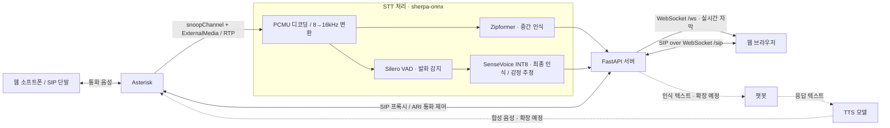

# Asterisk Integration

## 1. 프로젝트 개요

Asterisk와 STT·TTS 모델, 챗봇을 연결하는 음성 AI 연동 예제 프로젝트입니다.  
전화 음성을 텍스트로 변환하고, 챗봇의 응답을 합성 음성으로 전달하는 구성을 목표로 합니다.  
현재 Asterisk–STT와 웹 소프트폰·실시간 자막을 구현했으며, 챗봇·TTS 연동은 확장 예정입니다.

## 2. 아키텍처 구성도



실선은 현재 구현된 경로, 점선은 챗봇·TTS 확장 경로입니다. 웹 소프트폰은 브라우저에서 SIP.js로 동작하며, 음성은 WebRTC로 Asterisk에 전달합니다. Zipformer의 중간 인식 결과가 없으면 SenseVoice가 보완합니다.

## 3. 프로젝트 빌드 및 실행 방법

### 준비 사항

- Docker Engine 또는 Docker Desktop과 Docker Compose
- Python 3.11 이상
- 모델·이미지 다운로드를 위한 인터넷 연결 및 여유 디스크 약 3GB 이상

### 최초 빌드 및 실행

프로젝트 루트에서 실행합니다.

```sh
cd ~/workspaces/Asterisk-Integration
./scripts/start.sh
```

스크립트가 STT 모델 다운로드, Docker 이미지 빌드, 컨테이너 실행을 순서대로 수행합니다.

### 접속 및 통화 확인

1. 브라우저에서 http://localhost:8000 에 접속합니다.
2. 화면이 열리면 SIP가 자동 등록됩니다. 기본 내선은 `1003`, 비밀번호는 `demo-web-1003`입니다.
3. `9998`로 발신하고 마이크를 허용하면 발화 내용이 실시간 자막으로 표시됩니다.
4. 확인 후 **통화 종료**를 누릅니다.

기본 포트는 웹 UI `8000/TCP`, SIP 단말 `15060/UDP`, 통화 음성 `12000–12020/UDP`이며, 동일 호스트에서 사용하는 로컬 데모 구성입니다.

```sh
# 실행 상태 및 준비 상태 확인
docker compose ps
curl -f http://localhost:8000/health/ready

# STT 서버 로그 확인
docker compose logs -f stt

# 종료
docker compose down

# 이후 재실행
docker compose up -d --wait
```

### 소스 수정 후 재빌드

```sh
docker compose build
docker compose up -d --force-recreate --wait
```

웹 소프트폰의 `web/src/phone.js`를 수정했다면 Node.js와 npm이 필요하며, Docker 이미지 빌드 전에 아래 명령으로 번들을 갱신합니다. 일반 실행에는 저장소에 포함된 번들을 사용합니다.

```sh
npm --prefix web ci
npm --prefix web run build
```
