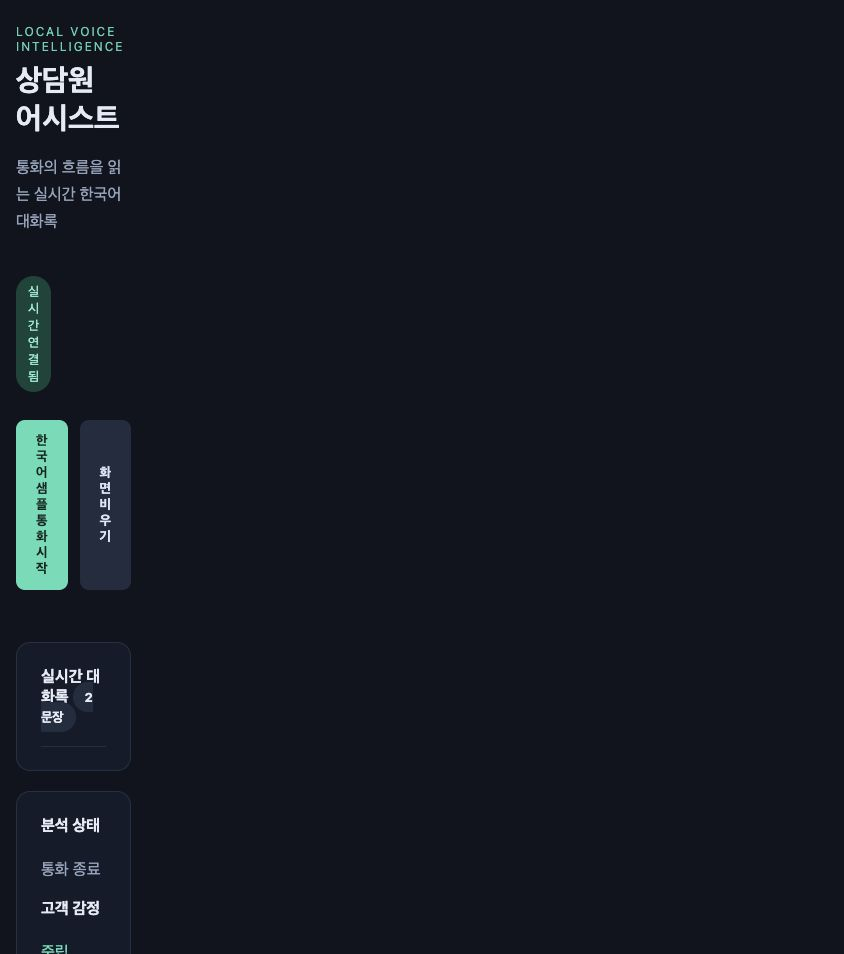

# 검증 결과 — 2026-10-18 (Asia/Seoul)

## 결과

README의 모델 다운로드·Asterisk 구성·ARI/RTP·2-Pass·웹 UI 구현을 완료했고, 실제 Asterisk 샘플 통화의 통합 검증을 통과했다. 다만 지정된 Zipformer의 8kHz 전화 대역 인식이 실패하여 SenseVoice 중간 인식 보완 경로를 추가했다. 이를 native streaming 성공으로 해석하지 않는다.

| 항목 | 결과 | 증거 |
|---|---|---|
| 공식 모델 3종 확보 | 완료, 주요 파일 20개 SHA256 재검증 | model-verify.log, ../models/manifest.json |
| ARM64 컨테이너 | Asterisk/STT 모두 arm64, uname aarch64 | Docker image inspect 및 실행 확인 |
| Asterisk | 20.6.0, ARI 연결 및 health 정상 | 실행 로그 |
| Compose 구성 | config --quiet 통과 | 명령 실행 |
| Python 구문 | compileall 통과 | 명령 실행 |
| RTP/ARI 단위 테스트 | 8개 통과 | unit-tests-final.log |
| 실제 통합 테스트 | PASS | integration-verified.jsonl |
| 통화 종료 정리 | 원본/내부 채널 0, bridge 0, audio session 0 | channels-after-test.log, bridges-after-test.log, 통합 assert |
| 브라우저 직접 실행 | 버튼 → 통화 진행 → 최종 문장/중립 배지 → 종료/버튼 재활성화 확인 | ui-verified.jpg |
| 실제 소프트폰 2대 통화 | 미검증 | 외부 단말 등록·NAT 환경 별도 확인 필요 |

## 실측 (단일 4.61초 한국어 샘플, 앞뒤 무음 포함)

- 총 테스트 시간: 10.16초.
- 수신: 505 RTP 패킷, 수신 오디오 10.1초.
- malformed / late / lost / overflow: 모두 0.
- 중간 자막: 3회, engine=sensevoice-fallback.
- 최종 문장: 1개, emotion=NEUTRAL.
- SenseVoice 최종 추론 시간: 65.6ms. VAD 대기·네트워크·큐 대기는 포함하지 않는다.
- 총 추론 시간: 1.442초, RTF=0.143. 무음을 포함한 수신 오디오 기준이며 다채널 처리량 지표는 아니다.
- 첫 partial: call_started 약 4.29초 후. 샘플 앞의 2초 Wait와 음성 전처리/추론 시간이 포함된다. README의 100–250ms 자막 지연을 달성했다는 의미가 아니다.
- 종료 후 메모리 표본: STT 546.9MiB, Asterisk 47.94MiB. peak가 아닌 단회 docker stats 측정이다.
- 브라우저 재실행: 504 패킷, 손실/큐 초과 0, RTF=0.146.

최종 인식 원문은 `생각 을 하 면서 살 면 훨씬 편할 거야.`이다. 원본의 첫 구절 누락 및 부자연스러운 띄어쓰기가 관찰된다. 이 테스트는 데이터 경로·UI·자원 정리의 검증이며 한국어 정확도, 금융 도메인 품질 또는 감정 정확도 검증이 아니다. 실제 상담 데이터의 CER/WER 측정과 VAD 튜닝은 후속 과제다.

## Zipformer 비교 실험

`scripts/probe_telephony.py`는 두 공식 샘플을 원본과 soxr 8kHz→16kHz 왕복으로 비교한다. INT8/FP32 양쪽에서 원본 4건은 한국어 출력, 전화 대역 4건은 빈 문자열이었다. 실험 결과는 telephony-probe.log에 저장했다. 해당 관찰을 근거로 보완 경로를 추가했으며 모델 자체의 일반적 한국어 성능을 단정하지 않는다.

## 남은 제한

- 샘플은 1종이며 실제 양방향 PJSIP 단말·장시간·동시 통화 부하는 실측하지 않았다.
- 8kHz 환경의 native streaming은 미달성이다. 보완 경로는 SenseVoice pseudo-streaming이다.
- 패킷 재정렬 대기나 큰 손실 복원은 없으며 Compose 내부망을 대상으로 한다.
- 자막·감정 API에는 사용자 인증이 없다. 기본 포트는 loopback에만 노출된다.
- ARI 단절 시 정리를 시도하지만 Asterisk가 응답하지 않는 동안 REST 삭제를 보장할 수 없다. 운영용 재조정·영속 상태 복구는 범위 밖이다.
- 패키지 직접 의존성은 고정했고 전체 설치 버전은 runtime-packages.txt에 기록했다. OS base image 및 간접 의존성까지 재현 가능한 digest lock은 추가되지 않았다.

## 재실행

```sh
python3 scripts/download_models.py --verify
docker compose run --rm --no-deps -v "$PWD/tests:/tests:ro" stt python -m unittest discover -s /tests -v
docker compose exec -T stt python - < scripts/integration_test.py
docker compose exec -T stt python - < scripts/probe_telephony.py
```



## 추가 검증 — 웹 소프트폰 (2026-10-19)

브라우저 SIP.js 등록/해제를 확인했다. aiortc WAV 입력으로 9998/9999 실제 SIP 발신 및 ICE/DTLS-SRTP 음성 송수신, STT 자막, BYE 종료를 검증했다. 단위 테스트는 9개로 증가했고 기존 Local 통화 회귀 테스트도 통과했다. 실제 브라우저 마이크를 사용한 통화와 외부 소프트폰 2대 테스트는 아직 별개로 미검증이다. 상세 증거 및 재실행 절차는 [WEBPHONE.md](WEBPHONE.md)에 있다.
